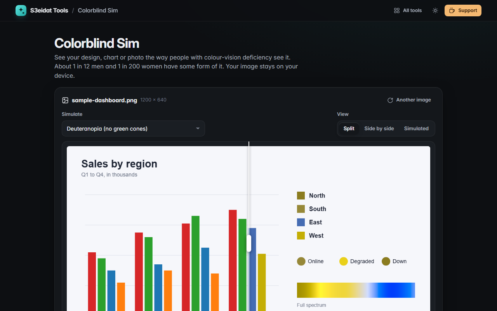

# Colorblind Sim

> See images, designs and charts the way people with colour-vision deficiency see them. Free, private, and it runs entirely in your browser.

### ▶ [Open Colorblind Sim](https://s3eidat.github.io/colorblind-sim/)



## Features

- **Seven simulations**: protanopia, deuteranopia, tritanopia, their milder forms (protanomaly, deuteranomaly,
  tritanomaly) with a **severity slider**, and achromatopsia (no colour)
- **Split view** with a draggable divider, **side by side**, or simulated only
- **All types at a glance**: a grid of every simulation, click one to inspect it
- Drop, choose or **paste** (Ctrl+V) any image or screenshot; or try the built-in sample chart
- **Export** the current simulation as PNG at full resolution, or **all types as a zip**
- A short explanation of each type, how common it is, and practical design tips

## How it works

Pixels are converted from sRGB to linear light, multiplied by the dichromacy matrices of
Machado, Oliveira and Fernandes (2009), *A Physiologically-based Model for Simulation of Color Vision Deficiency*,
and converted back. The milder (anomalous) forms are approximated by blending normal vision with the full
dichromacy in linear light, by the chosen severity. Achromatopsia uses Rec. 709 luminance.
Simulations are an approximation: real colour vision varies from person to person.

## Privacy

Your image never leaves your device; all processing happens in this tab. There is no server, no account, no analytics.
The page ships with a strict Content-Security-Policy (`connect-src 'self'`), so the browser itself blocks any attempt to
send data anywhere. Only your settings are remembered in this browser.

## Run it yourself

It's plain HTML, CSS and JavaScript with no build step:

```bash
git clone https://github.com/s3eidat/colorblind-sim
cd colorblind-sim
python -m http.server 8000
```

Then open http://localhost:8000.

## Support

If this saved you time, **[buy me a coffee ☕](https://s3eidat.github.io/coffee/)**. It keeps every tool free.

---

Part of **[S3eidat Tools](https://s3eidat.github.io/)**: 100+ free, private tools that run in your browser. MIT licensed.
